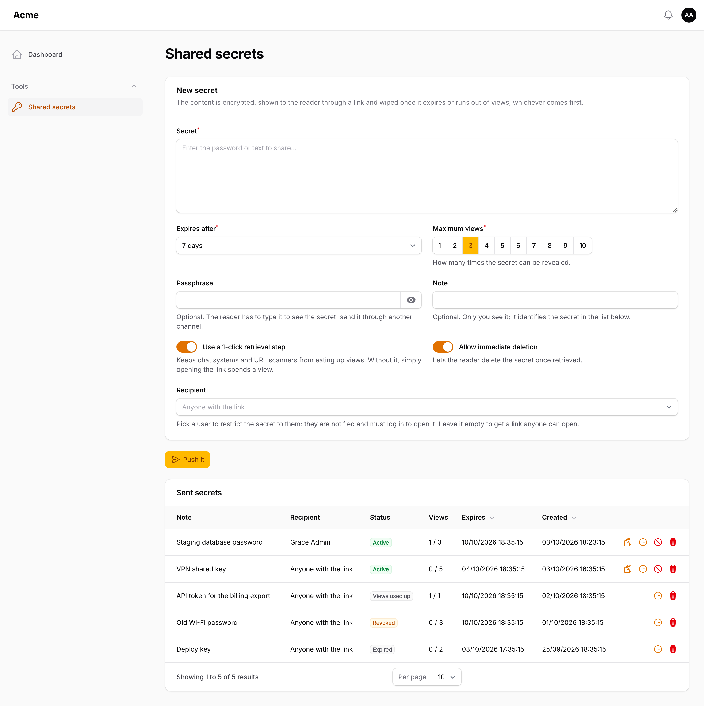
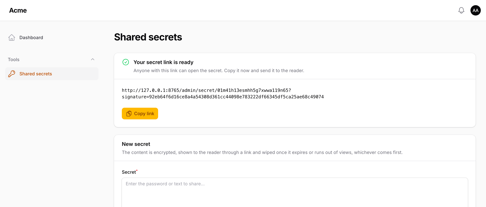
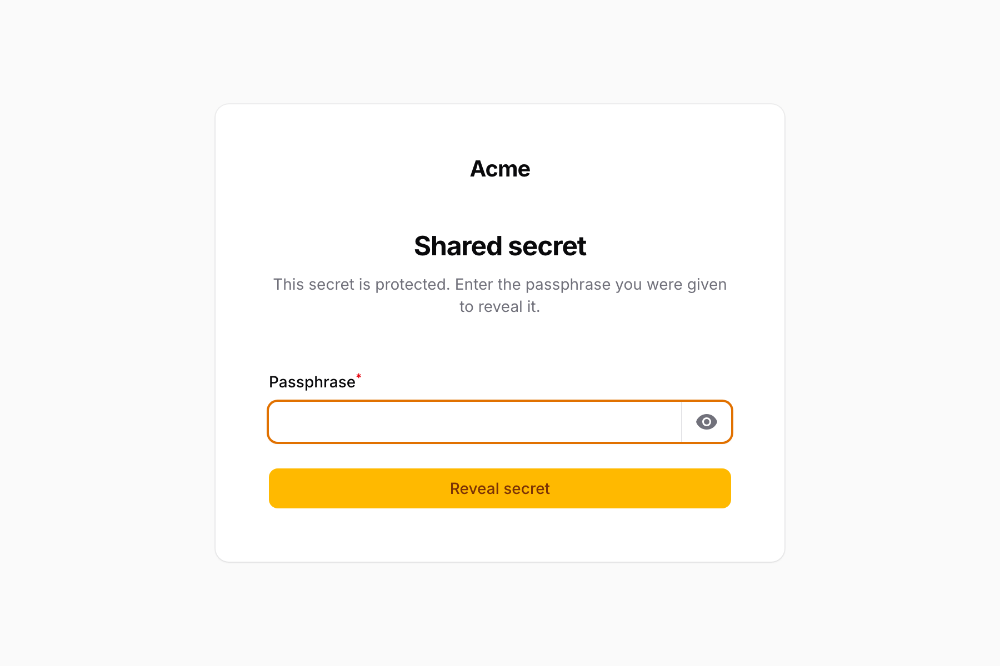
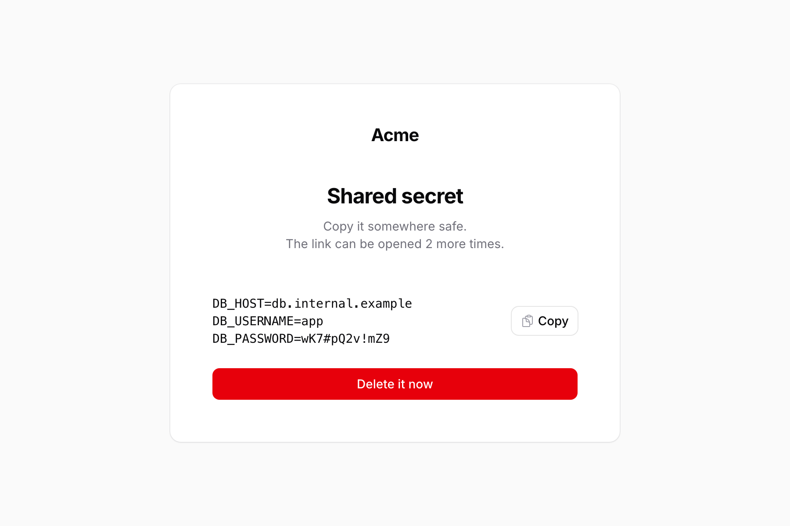

# Shared Secrets

Share passwords and secrets from your Filament panel through self-destructing signed links, in the spirit of
[Password Pusher](https://oss.pwpush.com/).

A panel user pastes a secret, picks how long it lives and how many times it can be viewed, and gets a signed link.
The content is encrypted at rest and wiped as soon as it expires, runs out of views, is revoked or is deleted by its
reader. A secret can also be targeted at a user of the site, who is notified and must log in to open it.



## Screenshots

After pushing a secret, its link is shown in place, ready to copy:



The reader opens the link and confirms before a view is spent:


A secret can require a passphrase:



Once revealed, the reader can copy the secret, sees how many views are left and, when the sender allows it, can delete
it straight away:



## Requirements

- PHP 8.4+
- Laravel 12 or 13
- Filament 5.8+

## Installation

```bash
composer require arzcode/shared-secrets
php artisan shared-secrets:install
```

The installer:

1. publishes the migration (`create_shared_secrets_tables`),
2. asks whether to publish the config file (`config/shared-secrets.php`),
3. asks whether to run the migrations,
4. asks, for each `app/Providers/Filament/*PanelProvider.php`, whether to register `SharedSecretsPlugin` in it.

Re-running it is safe: it never publishes the migration or registers the plugin twice, and it leaves an existing
config file alone.

To install by hand instead:

```bash
php artisan vendor:publish --tag=shared-secrets-migrations
php artisan vendor:publish --tag=shared-secrets-config
php artisan migrate
```

```php
use Arzcode\SharedSecrets\SharedSecretsPlugin;

$panel->plugins([
    SharedSecretsPlugin::make(),
]);
```

## Plugin options

```php
SharedSecretsPlugin::make()
    ->navigationGroup(fn () => __('Tools'))          // string, enum or closure
    ->navigationSort(10)
    ->navigationIcon(Heroicon::OutlinedKey)
    ->authorize(fn (User $user) => $user->isAdmin()) // who may share secrets; default: every panel user
    ->viewAllSecrets(fn () => false)                 // list everyone's secrets instead of only your own
    ->recipients(true)                               // allow targeting a user of the site
    ->recipientQuery(fn ($query) => $query->where('active', true))
    ->recipientLabel(fn (User $user) => "{$user->name} {$user->surname} · {$user->role->getLabel()}") // default: user_title_attribute
    ->revealPath('secret')                           // URL segment of the reader link, inside the panel path
    ->revealLogoHeight('6rem');                      // logo height on the reader page; null keeps the panel's
```

Lifetimes, the maximum number of views, passphrase throttling, the retention of closed secrets and the notification
channels are set in `config/shared-secrets.php`.

### Languages

When your site describes its languages with a backed enum or an Eloquent model, point `languages.source` at it and the
push form offers a language selector. The reader page and the recipient's notifications are shown in the chosen
language; the values must be locales your application has translations for (`en`, `es`, `pt_BR`…).

```php
'languages' => [
    'source'          => App\Enums\Language::class, // or App\Models\Language::class
    'value_attribute' => 'code',                     // model only: the column holding the locale
    'label_attribute' => 'name',                     // model only: the column shown in the select
    'fallbacks'       => ['ba' => 'ca'],             // regional variants: where their missing strings come from
    'hosts'           => null                        // one domain per language: ['ca' => 'example.cat', 'es' => 'example.es']
],
```

A regional variant usually only translates what differs from its base language. Without a `fallbacks` entry, its
missing strings come from the translator's current fallback, which a panel's locale middleware may have set to another
language. Mapped, the reader page and both notifications fill them in from the locale you name.

When each language lives on its own domain, `languages.hosts` maps a locale to its host and the reader's link is built
(and signed) on it. A regional variant uses its fallback's host, and a locale without one keeps the application URL. Pass
the map itself or a static method that returns it, `[App\Enums\Language::class, 'hosts']`, which still works with
`config:cache`; it is called once per request or queued job. A host given without a scheme takes the one of `app.url`,
and a value with a path or a query is ignored.

Every host listed must reach the application and serve the panel's routes. A guest opening a secret targeted at a user is
sent to the login on the same host, so they log in to the session that remembers the link. A panel bound to its own
domains (`->domain()`) keeps its links and its login there and ignores `languages.hosts`.

Each host also needs a working session, since the reader page and the login both rely on it: leave `SESSION_DOMAIN`
empty so every domain keeps its own cookie, or serve the languages from subdomains (`es.example.com`) and set it to
`.example.com` to share one session. A `SESSION_DOMAIN` that the language hosts are not part of leaves them without a
session, and the reader page fails with 419 errors. If the application trusts only some hosts (`TrustHosts`), list every
language host. With separate domains, a recipient logs in once per domain, and logins bound to a single domain (passkeys,
social or single sign-on callbacks registered for the main domain only) do not work on the others; use subdomains in that
case.

An enum is labelled with `getLabel()` when it implements Filament's `HasLabel`, with its case name otherwise. It ships as
`null`, which hides the selector.

Upgrading from 1.0.x: the language is stored in a new column, which is never touched until it exists. Until then the
language field is disabled and shows what to run: `php artisan vendor:publish --tag=shared-secrets-migrations`
and `php artisan migrate`.

## How it works

- **The link** is `/{panel}/secret/{id}?signature=…`. The signature proves the link was issued by your application;
  expiry and views are enforced from the database, so a spent link shows a "no longer available" page.
- **Targeted secrets** only open for their recipient. Guests are sent to the login page of a panel the recipient can
  access and brought back afterwards; anyone else gets a 403. The recipient receives an email and, when a panel they
  can access shows database notifications, a notification in the panel.
- **The 1-click retrieval step** keeps chat previews and URL scanners from spending views. Without it, the page
  reveals the secret as soon as a browser loads it. Fetching the link never spends a view by itself, so a scanner
  that does not run JavaScript cannot use one up.
- **A passphrase** can be required. Wrong attempts are throttled per IP address and, past a limit from any address,
  pause the secret for `passphrase.lockout_minutes`. The secret is never wiped by wrong attempts.
- **The content is never shown again** to its sender. An optional note, also encrypted, identifies a secret in the
  list; the activity log records every view with its time, user, IP address and browser.
- **Pruning**: `php artisan shared-secrets:prune` wipes expired secrets and deletes the rows closed more than
  `prune_after_days` ago. It is scheduled hourly unless `schedule.enabled` is off.

## Uninstalling

```bash
php artisan shared-secrets:uninstall
```

After a confirmation, it removes `SharedSecretsPlugin` from your panel providers without asking again. It then asks,
one by one and defaulting to "no", whether to drop the tables, delete the published migration, delete the published
config file and delete any published translations. It ends by running `composer remove arzcode/shared-secrets`.

## Testing

```bash
composer test
composer analyse
composer format
```
